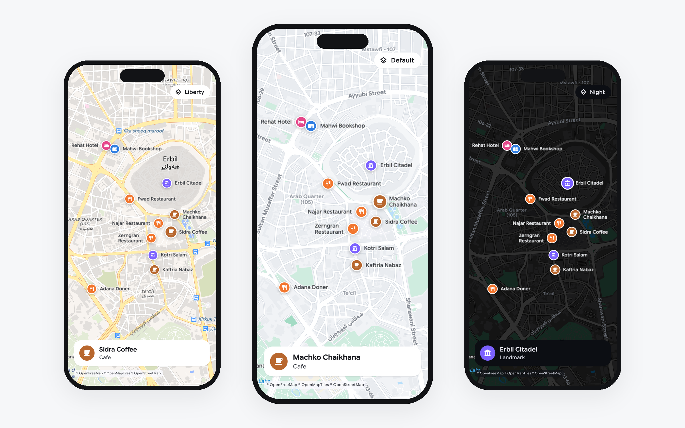

A map engine for Flutter, drawn on the GPU. It reads any MapLibre style and
draws it the way MapLibre does, with 3D buildings, terrain, the globe and
labels in every script, on Android, iOS, macOS, Windows, Linux and the web.

- **Any MapLibre style**: 1,394 of the 1,519 MapLibre render tests that
  apply, and real styles within a few percent of MapLibre GL JS.
- **3D**: buildings with depth, terrain draped with the map, sky and fog,
  the globe, tilt up to 85 degrees.
- **Labels in every script**, Arabic and Kurdish shaped correctly, placed
  and kept apart as MapLibre places them, and steady while the map moves.
- **Flutter all the way down**: one widget, markers that are widgets,
  gestures for touch, mouse, trackpad and keyboard, no platform views.
- **Your own data**: GeoJSON with clustering, feature state for
  highlighting, a lookup of what is under a tap with its geometry.
- **Offline**: a disk cache, regions downloaded ahead, and PMTiles archives.

## Install

```bash
flutter pub add vmap
```

vmap needs Flutter 3.47.1 or newer. Switch Flutter GPU on in your app, once
per platform:

| Platform | Where | What |
| --- | --- | --- |
| Android | `android/app/src/main/AndroidManifest.xml`, inside `<application>` | `<meta-data android:name="io.flutter.embedding.android.EnableFlutterGPU" android:value="true" />` |
| iOS, macOS | `ios/Runner/Info.plist`, `macos/Runner/Info.plist` | `<key>FLTEnableFlutterGPU</key><true/>` |
| Windows | `windows/runner/main.cpp`, after `DartProject project(...)` | `project.set_enable_flutter_gpu(true);` |
| Linux | `linux/runner/my_application.cc`, after `fl_dart_project_new()` | `fl_dart_project_set_enable_flutter_gpu(project, TRUE);` |
| Web | nothing | vmap draws through WebGL2 |

`flutter run --enable-flutter-gpu` switches it on for one run. Where
Flutter GPU is off or missing, the map is drawn with Flutter's canvas
instead: flat buildings, no terrain or globe. In debug builds vmap says so
in the console, and `onError` hears it as a `VmapErrorKind.gpu` error.

On macOS the app also needs the `com.apple.security.network.client`
entitlement to load tiles.

## Quick start

```dart
import 'package:flutter/material.dart';
import 'package:vmap/vmap.dart';

class MapPage extends StatelessWidget {
  const MapPage({super.key});

  @override
  Widget build(BuildContext context) => const Scaffold(
    body: Vmap(
      initialCamera: VmapCamera(center: LatLng(36.19, 44.01), zoom: 14),
    ),
  );
}
```

That is a whole map: vmap's built in style over
[OpenFreeMap](https://openfreemap.org) tiles (no key), gestures, and the
credit the tiles ask for in the corner. The [example](example/lib/main.dart)
adds a style switcher, a marker, taps and 3D in a hundred lines.

## Styles

```dart
Vmap(style: VmapStyle.light)  // built in, the default
Vmap(style: VmapStyle.dark)   // built in
Vmap(style: VmapStyle.url('https://tiles.openfreemap.org/styles/liberty'))
Vmap(style: VmapStyle.json(myStyleDocument))
```

The style decides the look and where the tiles come from. A style given as
JSON is compared by identity: decode it once and keep it, rather than in
`build`, or the map loads it again on every build.

To change one layer of a style without writing it out again, name the layer
by its `id`:

```dart
Vmap(
  style: VmapStyle.url('https://tiles.openfreemap.org/styles/liberty'),
  styleEdits: [
    const VmapStyleEdit.paint('water', 'fill-color', '#2a6fdb'),
    const VmapStyleEdit.visible('building', false),
    const VmapStyleEdit.filter('poi_r1', ['==', 'class', 'hospital']),
    VmapStyleEdit.zoomRange('road_minor', min: 14),
  ],
)
```

These are MapLibre's `setPaintProperty`, `setLayoutProperty`, `setFilter`
and `setLayerZoomRange`, given as a list. A change of paint keeps the tiles
loaded and animates as the style's transitions say; a filter, a zoom range
or a layout property builds the tiles again behind what is on screen.

## The camera

A `VmapController` moves the map and reads where it looks. Zooms are
MapLibre's: the world is 512 pixels wide at zoom 0.

```dart
final controller = VmapController(
  const VmapCamera(center: LatLng(36.19, 44.01), zoom: 14),
);

Vmap(controller: controller)

controller.flyTo(const VmapCamera(center: LatLng(35.56, 45.44), zoom: 15, pitch: 55));
controller.easeTo(controller.camera.copyWith(bearing: 90));
controller.fitBounds(
  VmapBounds.around(points),
  padding: const EdgeInsets.all(40),
  duration: const Duration(milliseconds: 600),
);
controller.camera = someCamera; // jump
```

`flyTo` follows MapLibre's path, rising over long distances. A moving camera
carries its speed into the next animation, and a released gesture glides.
`VmapCamera.padding` keeps part of the map free, under a sheet for example:
the camera looks at the middle of what is left. `toScreen` and `toLatLng`
convert between places and points on the map.

Gestures: one finger pans; two pinch, turn, and tilt when dragged up or down
together; a double tap zooms in, a two finger tap out, and a double tap held
and dragged zooms. A mouse wheel zooms, a right drag turns and tilts, a
trackpad pans, pinches and turns, and the arrow keys, `+` and `-` work once
the map has focus. `rotate`, `tilt`, `keyboard` and `interactive` switch
them off.

## Markers

Markers are widgets placed at points. Map labels keep out of their way, and
a marker's `name` is written beside it wherever there is room.

```dart
Vmap(
  markers: [
    VmapMarker(
      point: const LatLng(36.18946, 44.00970),
      name: 'Machko Chaikhana',
      width: 32,
      height: 32,
      alignment: Alignment.topCenter, // the box sits above the point
      child: GestureDetector(
        onTap: () => showCafe(),
        child: const Icon(Icons.location_on, size: 32),
      ),
    ),
  ],
)
```

A tap on a marker is the marker's; it does not reach `onTap`.

For the places the style shows, `pins: VmapPins.standard` draws round pins
in place of the style's small icons (the app needs
`uses-material-design: true`). Spread `VmapPins.standardIcons` into `byIcon`
to change some of them.

## What is under a tap

```dart
Vmap(
  controller: controller,
  onTap: (point) async {
    final features = await controller.featuresAt(point);
    if (features.isEmpty) return;
    final top = features.first;
    print('${top.properties['name']} from ${top.layers.first}');
  },
)
```

`featuresAt` gives what the style draws at that point, topmost first: roads,
buildings, places, and the features of your overlay, each with its
properties, its source, the ids of the style layers drawing it, and its
geometry. It reads the tiles off the UI thread, so it answers a moment
later. `featuresIn` gives everything touching an area.

To highlight a feature, give it state that the style reads with
`['feature-state', name]`:

```dart
Vmap(
  featureStates: [
    if (picked != null) VmapFeatureState.of(picked!, const {'picked': true}),
  ],
)
```

with a paint property such as
`['case', ['==', ['feature-state', 'picked'], true], '#E5484D', '#1A73E8']`.
The feature needs an id: a GeoJSON feature's `id`, the id its vector tile
carries, or a property named by the source's `promoteId`.

## Your own data

An overlay adds sources and layers to whatever style is showing, written as
a MapLibre style writes them:

```dart
const route = VmapOverlay(
  sources: {
    'route': {
      'type': 'geojson',
      'data': {
        'type': 'Feature',
        'properties': {},
        'geometry': {
          'type': 'LineString',
          'coordinates': [[44.0053, 36.1930], [44.0087, 36.1890]],
        },
      },
    },
  },
  layers: [
    {
      'id': 'route',
      'type': 'line',
      'source': 'route',
      'layout': {'line-cap': 'round'},
      'paint': {'line-color': '#1A73E8', 'line-width': 5},
    },
  ],
);

Vmap(overlay: route)
```

A layer with `'before': 'some-layer-id'` is drawn under that layer of the
style. `data` may also be the address of a GeoJSON file. To change what is
shown, build a new overlay with a new `data` object; what it drew stays up
until the new data is ready, so a moving dot does not blink.

A GeoJSON source with `'cluster': true` gathers its points into clusters
with MapLibre's options and properties. `clusterExpansionZoom`,
`clusterChildren` and `clusterLeaves` on `controller.engine` say where a
cluster comes apart and what it holds.

## Fonts and languages

By default letters come from the style's glyph ranges, as MapLibre draws
them, and the app's fonts take over for what ranges cannot shape: Arabic
script letters that need joining forms, such as Kurdish ڵ and ێ, and styles
without glyphs. `VmapRenderOptions(glyphs: VmapGlyphs.fonts)` draws every
label from fonts instead.

```dart
Vmap(
  textStyle: const VmapTextStyle(
    fontFamily: 'Inter',
    fontFamilyFallback: ['Vazirmatn'],
  ),
  style: VmapStyle.url(styleUrl, nameKeys: ['name:en', 'name']),
)
```

`nameKeys` picks the label language, tried in order. vmap ships Vazirmatn
and Noto Sans Syriac Eastern (300 KB together) so Arabic script and Syriac
are shaped with no setup.

## Offline

```dart
Vmap(network: VmapNetworkOptions(cacheDirectory: '${dir.path}/vmap'))
```

With a cache directory, tiles, styles and sprites are kept between runs; the
next start draws from disk at once and checks the server behind it.
`controller.engine!.downloadRegion(...)` fetches every tile the style draws
for an area and range of zooms into the cache ahead of time.

A source whose address starts with `pmtiles://` is read from a
[PMTiles](https://docs.protomaps.com/pmtiles/) archive, on a server that
answers range requests or on the device, for vector, raster and hillshade
sources. Archives packed with gzip are read; brotli and zstd are not.

`VmapNetworkOptions` also sets the user agent and headers sent with every
request, for servers that want a key or a token.

## Loading, events and errors

```dart
Vmap(
  loadingBuilder: (context) => const Center(child: CircularProgressIndicator()),
  onStyleLoaded: () {},
  onCameraMove: (camera) {},
  onCameraIdle: (camera) {},
  onIdle: () {},
  onError: (error) => log('${error.kind} ${error.url}: ${error.cause}'),
)
```

The loading builder covers the map until it first draws tiles. `onError`
hears every style, tile, sprite, font or GPU failure as a `VmapError`; the
map keeps retrying where that can help.

## 3D, terrain and the globe

Styles with `fill-extrusion` layers stand their buildings up when the map is
tilted. A style's root `terrain` raises the ground, or an overlay adds one:

```dart
VmapOverlay(
  sources: {
    'dem': {
      'type': 'raster-dem',
      'tiles': ['https://s3.amazonaws.com/elevation-tiles-prod/terrarium/{z}/{x}/{y}.png'],
      'encoding': 'terrarium',
      'maxzoom': 15,
    },
  },
  terrain: {'source': 'dem', 'exaggeration': 1.5},
)
```

A style with `"projection": {"type": "globe"}` draws the globe at low zooms,
and `sky` draws the sky and fog past the horizon.

## Platforms

| Platform | Draws with | Run so far |
| --- | --- | --- |
| Android 10 and newer | the GPU, on Vulkan or OpenGL ES | one phone and the emulator |
| Android 9 and older | the canvas | not yet |
| iOS | the GPU | not yet |
| macOS | the GPU | yes, most development |
| Windows, Linux | the GPU | not yet |
| Web | the GPU, through WebGL2 | Chrome |

The details, with sources, are in
[doc/platform-support.md](doc/platform-support.md). Flutter GPU is still a
preview in Flutter itself.

On the web, tiles are built in a web worker vmap ships, so loading an area
does not hold up the page; `VmapEngine.useWebWorker(null)` before the first
map builds them on the page instead. There is no disk cache in a browser,
and a PMTiles archive has to be at an `https://` address. Use the default
JavaScript build: the `--wasm` build has frozen its tab in some runs.

## flutter_map

Apps that already use [flutter_map](https://pub.dev/packages/flutter_map)
can draw vmap's maps in it with the `vmap_flutter_map` package: a layer that
goes where a `TileLayer` would, without tilt or 3D.

## Moving from vmap 0.26

- `VmapLayer`, `VmapMap` (now `VmapFlutterMap`), `VmapGestures` and
  `NamedMarker` are in `vmap_flutter_map`.
- `VMap` and `VMapController` are `Vmap` and `VmapController`.
  `MapCameraPosition` is `VmapCamera`, with a `LatLng` center, `EdgeInsets`
  padding and a field of view in degrees.
- The GPU renderer is built in and used by default; `GpuMap` is gone. Pick
  the canvas with `VmapRenderOptions(renderer: VmapRenderer.canvas)`.
- Engine settings are grouped: `VmapNetworkOptions` (was
  `TileSourceConfig`), `VmapRenderOptions` and `VmapLabelOptions`.
  `glyphText` and `styleGlyphs` are one setting, `VmapRenderOptions.glyphs`.
- Every zoom the engine takes or gives is MapLibre's, one below
  flutter_map's.
- `onError` receives a `VmapError`. Statistics are in
  `package:vmap/debug.dart`.

## License

MIT. vmap bundles Vazirmatn and Noto Sans Syriac Eastern under the SIL Open
Font License, and its WebGL2 backend comes from
[flutter_scene](https://pub.dev/packages/flutter_scene) (MIT). Map data in
the pictures is from OpenStreetMap.
