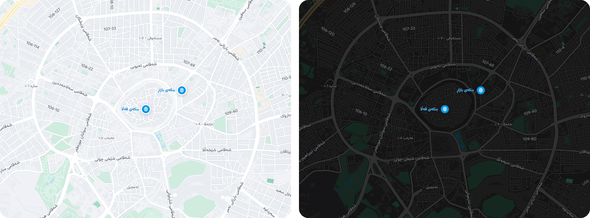

# vmap

A vector tile layer for [flutter_map](https://pub.dev/packages/flutter_map),
drawn with the plain Flutter canvas.


- **Runs wherever Flutter runs.** It draws with `Canvas`, so it needs no
  `flutter_gpu`, no Impeller and no minimum Android version beyond Flutter's
  own. Stable channel, Skia or Impeller.
- **Does not drop frames while tiles load.** Tiles are downloaded, decoded and
  turned into triangles on background isolates. The UI thread only draws.
- **Sharp at every zoom.** The map is redrawn from vectors every frame, so
  roads and names never go soft between zoom levels.
- **Text that reads right in any script.** Labels are shaped by Flutter's own
  text engine, so Arabic script, Kurdish and other right to left or joined
  scripts render correctly, with your app's fonts.
- **Labels that know about your markers.** Tell the map where your pins are:
  map labels keep clear of them, and each pin can have a name placed beside
  it.
- **Light and dark** palettes built in, a disk cache, and optional gesture
  handling tuned for maps.



## How it compares to vector_map_tiles

[vector_map_tiles](https://pub.dev/packages/vector_map_tiles) is the
established vector layer for flutter_map and does far more than vmap: it reads
Mapbox style JSON, sprites, hillshade and many tile sources. vmap is narrower
and makes different trade-offs.

| | vmap | vector_map_tiles |
| --- | --- | --- |
| Drawing | Flutter `Canvas`, vectors redrawn every frame | 8.x and 9.x: tiles rendered to images, then drawn. 10.x beta: `flutter_gpu` |
| Flutter channel | stable | 8.x and 9.x: stable. 10.x beta: main channel with Flutter GPU enabled |
| Renderer needed | Skia or Impeller | 10.x beta needs Impeller, which Flutter enables on Android API 29 and up |
| Styles | one built in style, light and dark palettes | any Mapbox GL style JSON |
| Tile schema | OpenMapTiles | whatever the style describes |
| Marker aware labels | yes | no |


The same camera and the same tile data: vmap on the left, vector_map_tiles
with the OpenFreeMap Positron style on the right.

The 10.x requirements are taken from that version's own README, and the
Impeller availability from
[Flutter's Impeller page](https://docs.flutter.dev/perf/impeller).

### Measured

One phone (vivo V2514, MediaTek MT6993, Android 16), profile builds, Flutter
3.47.5 stable, the display running the app at 60 Hz. The benchmark app in
`example/` flies a fixed 23 second tour around Erbil twice: pans, a zoom from
12.5 to 16 and back out to 10.5. vector_map_tiles is `9.0.0-beta.13`, the
newest version that runs on the stable channel with flutter_map 8, using the
OpenFreeMap Positron style. Both read the same OpenFreeMap tiles.

**First run after install, nothing cached** (tiles are downloaded and built
while the tour runs):

| | vmap | vector_map_tiles |
| --- | --- | --- |
| Frames skipped, lap 1 | 0 | 89 |
| Frames skipped, lap 2 | 0 | 13 |
| Hitches, lap 1 | 0 | 50 |
| Longest gap between frames | 17 ms | 149 ms |
| Frames drawn, lap 1 | 1384 | 1300 |

**Second run, tiles cached on disk:**

| | vmap | vector_map_tiles | raster `TileLayer` |
| --- | --- | --- | --- |
| Frames skipped | 0 | 1 | 1 |
| UI thread, median | 2.2 ms | 2.0 ms | 1.9 ms |
| UI thread, 99th percentile | 6.4 ms | 4.0 ms | 5.5 ms |
| Raster thread, median | 3.8 ms | 2.2 ms | 2.3 ms |
| Raster thread, 99th percentile | 6.7 ms | 3.7 ms | 3.5 ms |
| Frames over 16.7 ms | 0 | 1 | 0 |

Each number is the worse of the two laps. What that says: vmap does more
work per frame, because it redraws vectors
instead of blitting cached images, and it still fits a 60 Hz frame several
times over. Where it wins is steadiness: it did not skip a frame in either
run, including while every tile was still loading.

This is one device and one route. Run it on yours:

```bash
tool/bench_device.sh <adb-serial> ours
tool/bench_device.sh <adb-serial> vmt
tool/bench_device.sh <adb-serial> raster
```

## Install

vmap is not on pub.dev yet. Depend on it from git:

```yaml
dependencies:
  flutter_map: ^8.3.0
  vmap:
    git:
      url: https://github.com/ArinFaraj/vmap.git
      ref: v0.1.0
```

## Use

Create one engine, keep it for as long as the map is on screen, and put a
`VmapLayer` where a `TileLayer` would go.

```dart
import 'package:flutter/material.dart';
import 'package:flutter_map/flutter_map.dart';
import 'package:latlong2/latlong.dart';
import 'package:vmap/vmap.dart';

class MapPage extends StatefulWidget {
  const MapPage({super.key});

  @override
  State<MapPage> createState() => _MapPageState();
}

class _MapPageState extends State<MapPage> {
  final _controller = MapController();
  final _engine = VmapEngine(
    source: const TileSourceConfig(userAgent: 'com.example.app'),
    palette: VmapPalette.light,
  );

  @override
  void dispose() {
    _engine.dispose();
    super.dispose();
  }

  @override
  Widget build(BuildContext context) {
    return VmapGestures(
      controller: _controller,
      child: FlutterMap(
        mapController: _controller,
        options: const MapOptions(
          initialCenter: LatLng(36.1911, 44.0092),
          initialZoom: 12.5,
          interactionOptions: InteractionOptions(flags: InteractiveFlag.none),
        ),
        children: [VmapLayer(engine: _engine)],
      ),
    );
  }
}
```

`VmapGestures` replaces flutter_map's touch handling: drag with a glide, pinch
around the fingers, double tap, two finger tap, and double tap then drag. It is
optional. Leave it out and drop `InteractiveFlag.none` to keep flutter_map's
own gestures.

### Dark mode

```dart
_engine.palette = VmapPalette.dark;
```

### Label language and fonts

Names are read from the tile's properties in the order you give, so this
prefers English and falls back to the local name:

```dart
_engine.nameKeys = ['name:en', 'name:latin', 'name'];
```

Labels use any font your app bundles:

```dart
VmapEngine(
  font: const VmapLabelFont(
    fontFamily: 'Inter',
    fontFamilyFallback: ['Vazirmatn'],
  ),
);
```


Local names on the left, `name:en` first on the right.

### Markers

Draw markers the usual way, with flutter_map's `MarkerLayer`, and tell the
engine where they are. Map labels then keep clear of them, and a marker's
`label` is placed beside it, ahead of every map label.

```dart
_engine.markers = [
  const VmapMarker(36.1911, 44.0092, label: 'Citadel', width: 34, height: 34),
];
```

### Cache

Pass a directory and downloaded tiles are kept between runs:

```dart
TileSourceConfig(cacheDirectory: '${cacheDir.path}/vmap')
```

On the next start the map draws cached tiles at once and checks the tile
server in the background.

## Tiles and attribution

Tiles come from [OpenFreeMap](https://openfreemap.org) by default, which needs
no API key. Any server that publishes a TileJSON for the OpenMapTiles schema
works: set `TileSourceConfig.tileJsonUrl`.

Show this credit wherever the map is shown:
`© OpenFreeMap © OpenMapTiles © OpenStreetMap`.

## What it does not do

- Read Mapbox style JSON. The style is built in; you choose a palette.
- Sprites, icons and points of interest.
- Tile schemas other than OpenMapTiles.
- Rotation of labels with a rotated map has had little testing.
- It has been measured on one Android phone and run on macOS. iOS, web and low
  end devices are untested.

If you need any of those today, use vector_map_tiles.

## How it works

1. Worker isolates download each tile, decode the protobuf, triangulate
   polygons with earcut and widen roads into triangle strips. The result
   crosses to the UI isolate as transferable typed data.
2. Every frame, the engine draws the visible tiles with `Canvas.drawVertices`,
   one call per style layer, falling back to parent tiles while a tile loads.
3. Labels are collected across tiles, placed at screen level so they never
   collide or get cut at a tile edge, cached as small pictures and faded in
   and out.

## Example and benchmark app

`example/` is both. Run it for a map with a few markers:

```bash
cd example
flutter run
```

Compile time switches select what it does: `--dart-define=MODE=ours|vmt|raster`,
`TOUR=true` for the scripted tour, `DARK=true`, `NAMES=name:en,name` and
`ZOOM=125` (zoom times ten).

## License

MIT. The example bundles Google Sans Flex and Vazirmatn, both under the SIL
Open Font License; their license texts sit next to the font files.
