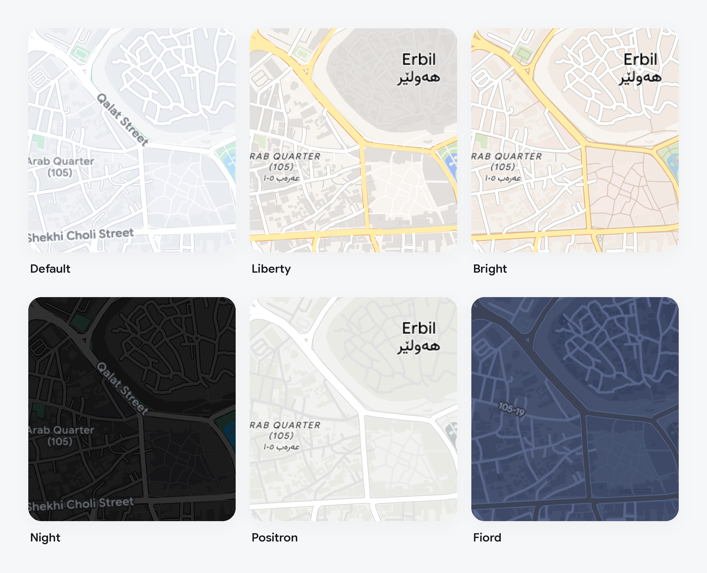
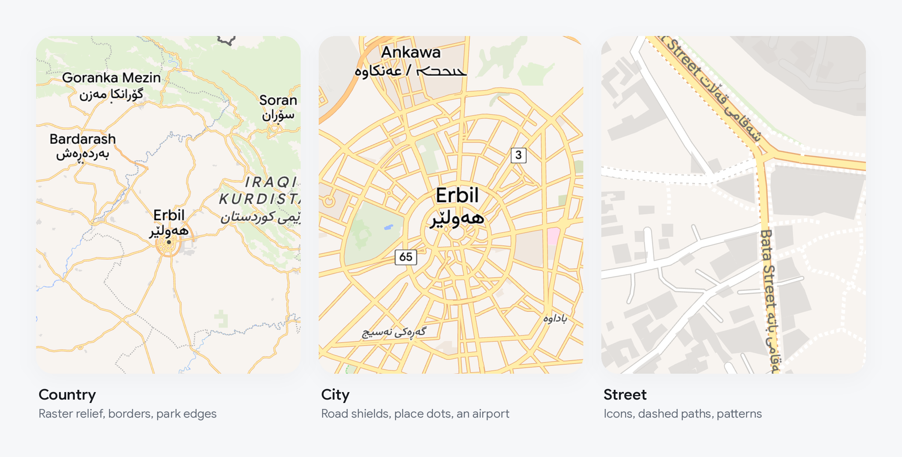
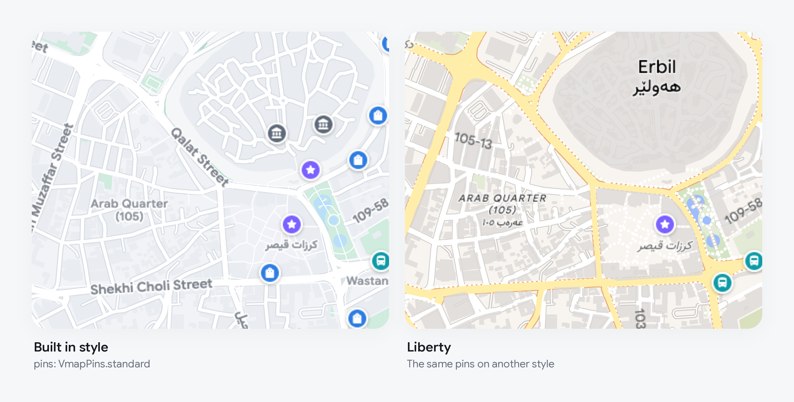
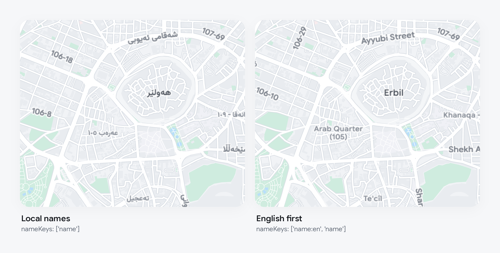

<h1 align="center">vmap</h1>

<p align="center">
  Vector maps for Flutter, drawn with the plain Flutter canvas.<br>
  Works with <a href="https://pub.dev/packages/flutter_map">flutter_map</a>
  and any MapLibre style.
</p>


- Reads any MapLibre style: colours, roads, labels, icons, dashes, patterns.
- Runs on the stable channel, on Skia or Impeller. No GPU package.
- Redraws from vectors every frame, so nothing goes soft between zoom levels.
- Tiles are loaded and built on background isolates.
- Labels in any script, in your app's own fonts.
- Its own gestures, with rotation, and optional round pins for places.
- Your own GeoJSON drawn with the style, and a lookup of what is under a tap.

## Install

vmap is not on pub.dev yet. Depend on it from git:

```yaml
dependencies:
  flutter_map: ^8.3.0
  latlong2: ^0.9.1
  vmap:
    git:
      url: https://github.com/ArinFaraj/vmap.git
      ref: v0.21.1
```

## Quick start

```dart
import 'package:latlong2/latlong.dart';
import 'package:vmap/vmap.dart';

VmapMap(
  initialCenter: const LatLng(36.19, 44.01),
  initialZoom: 14,
)
```

That is a full map: the built in style, tiles from
[OpenFreeMap](https://openfreemap.org) (no API key), and gestures.

### Already using flutter_map?

Keep your `FlutterMap` and swap the tile layer:

```diff
 FlutterMap(
   options: MapOptions(initialCenter: LatLng(36.19, 44.01), initialZoom: 14),
   children: [
-    TileLayer(urlTemplate: 'https://tile.openstreetmap.org/{z}/{x}/{y}.png'),
+    VmapLayer(),
     MarkerLayer(markers: markers),
   ],
 )
```

`VmapMap` and `VmapLayer` take the same options below. The snippets leave out
`initialCenter` to stay short.

## Styles



```dart
VmapMap(style: VmapStyle.light)  // built in, the default
VmapMap(style: VmapStyle.dark)   // built in
VmapMap(style: VmapStyle.url('https://tiles.openfreemap.org/styles/liberty'))
VmapMap(style: VmapStyle.json(jsonDecode(myStyle)))
```

The style decides the look and where the tiles come from. Light and dark
versions of one style switch without reloading a tile.



### Tiles from one file

A source whose address starts with `pmtiles://` is read from a
[PMTiles](https://docs.protomaps.com/pmtiles/) archive: a whole tile set in
one file, on any web server that answers range requests or on the device
itself. It works for vector, raster and hillshade sources.

```dart
'sources': {
  'city': {
    'type': 'vector',
    'url': 'pmtiles://https://example.org/city.pmtiles',
  },
  'offline': {
    'type': 'vector',
    'url': 'pmtiles:///data/user/0/my.app/files/region.pmtiles',
  },
}
```

An archive on the device needs no network at all, which is the way to ship
a map that works offline. Archives packed with gzip are read; brotli and
zstd are not.

## Pins

Styles draw places with small sprite icons. Pass `pins` to draw them as round
pins instead:

```dart
VmapMap(pins: VmapPins.standard)
```



The standard set covers the usual kinds of place: food, cafes, hotels, shops,
parks, sights, health, transport. It uses Material icons, so the app needs
`uses-material-design: true` in its pubspec.

To change it:

```dart
const pins = VmapPins(
  size: 26,
  byIcon: {
    ...standardPins,
    'cafe': VmapPin(Icons.coffee_rounded, Color(0xFF6F4E37)),
  },
);
```

A pin is looked up by the icon name the style gives a place. For OpenMapTiles
styles that is the place's class, such as `cafe` or `lodging`. Places with no
pin of their own get `other`, a grey pin; set `other: null` to leave them
with the style's icon.

These pins are part of the map and do not take taps. For places the user can
tap, use markers.

## Markers

Markers are flutter_map `Marker`s. Map labels keep out of their way. A
`NamedMarker` also gets its name written beside it, wherever there is room.

```dart
VmapMap(
  markers: [
    NamedMarker(
      name: 'Machko Chaikhana',
      point: const LatLng(36.18946, 44.00970),
      width: 34,
      height: 34,
      child: const CafePin(),
    ),
  ],
)
```

With `VmapLayer`, pass the same list to both layers:

```dart
VmapLayer(markers: markers),
MarkerLayer(markers: markers),
```

## Gestures

`VmapMap` comes with its own gestures: drag with a glide, pinch around the
fingers, turn with two fingers, double tap, two finger tap, and double tap
then drag. Labels stay upright while the map turns. `rotate: false` switches
turning off.

Move the map from code with a flutter_map `MapController`:

```dart
final controller = MapController();

VmapMap(controller: controller, onTap: (point) {})

controller.move(const LatLng(36.19, 44.01), 15);
```

To get the same gestures on your own `FlutterMap`, wrap it in `VmapGestures`
and set `InteractionOptions(flags: InteractiveFlag.none)`. flutter_map's own
gestures also work with `VmapLayer`.

## Your own data

An overlay adds sources and layers of your own to whatever style is showing.
Both are written the way a MapLibre style writes them, so anything a style
can draw, you can draw: lines, fills, circles, text, icons, heatmaps.

```dart
const route = VmapOverlay(
  sources: {
    'route': {
      'type': 'geojson',
      'data': {
        'type': 'Feature',
        'properties': {'name': 'Evening walk'},
        'geometry': {
          'type': 'LineString',
          'coordinates': [[44.0053, 36.1930], [44.0087, 36.1890]],
        },
      },
    },
  },
  layers: [
    {
      'id': 'route',
      'type': 'line',
      'source': 'route',
      'layout': {'line-cap': 'round'},
      'paint': {'line-color': '#1A73E8', 'line-width': 5},
    },
  ],
);

VmapMap(overlay: route)
```

A layer with `'before': 'some-layer-id'` is drawn under that layer of the
style instead of on top. `data` may also be the address of a GeoJSON file.

To change what is shown, build a new overlay with a new `data` object. Only
that source is read again, and what it drew stays up until the new data is
ready, so a dot that moves a few times a second does not blink. Keep the
overlay between builds: a new one in every `build` is treated as a change
every time.

### Many points

A GeoJSON source with `'cluster': true` gathers its points into clusters
that split apart as the map zooms in, with MapLibre's options and
properties:

```dart
VmapOverlay(
  sources: {
    'shops': {
      'type': 'geojson',
      'data': shops,
      'cluster': true,
      'clusterRadius': 45,
      'clusterMaxZoom': 14,
    },
  },
  layers: [
    {
      'id': 'clusters',
      'type': 'circle',
      'source': 'shops',
      'filter': ['has', 'point_count'],
      'paint': {
        'circle-color': '#1A73E8',
        'circle-radius': ['step', ['get', 'point_count'], 14, 20, 19, 80, 25],
      },
    },
    {
      'id': 'counts',
      'type': 'symbol',
      'source': 'shops',
      'filter': ['has', 'point_count'],
      'layout': {
        'text-field': ['get', 'point_count_abbreviated'],
        'text-allow-overlap': true,
      },
      'paint': {'text-color': '#FFFFFF'},
    },
    {
      'id': 'shop',
      'type': 'circle',
      'source': 'shops',
      'filter': ['!', ['has', 'point_count']],
      'paint': {'circle-color': '#1A73E8', 'circle-radius': 5},
    },
  ],
)
```

Tapping a cluster finds it like any other feature. Ask the layer, through a
`GlobalKey<VmapLayerState>`, where it comes apart and move there, or list
what it holds:

```dart
final layer = layerKey.currentState!;
final id = feature.properties['cluster_id']! as int;
final zoom = await layer.clusterExpansionZoom('shops', id);
if (zoom != null) mapController.move(tapped, zoom);
final shops = await layer.clusterLeaves('shops', id, limit: 20);
```

## What is under a tap

```dart
VmapMap(
  onFeatureTap: (point, features) {
    if (features.isEmpty) return;
    final top = features.first;
    print('${top.properties['name']} from ${top.layers.first}');
  },
)
```

`features` holds what the style draws at that point, topmost first: roads,
buildings, places, and the features of your overlay, each with its
properties, its source and the ids of the style layers drawing it. The answer
comes from the tiles off the UI thread, so it arrives a moment after the tap.

With your own `FlutterMap`, give the layer a `GlobalKey<VmapLayerState>` and
call `key.currentState!.featuresAt(point)`.

### Highlighting it

A paint property can read state you give a feature, with
`['feature-state', 'picked']`. Changing the state repaints and rebuilds
nothing:

```dart
'paint': {
  'fill-color': [
    'case',
    ['==', ['feature-state', 'picked'], true], '#E5484D',
    '#1A73E8',
  ],
},
```

```dart
VmapMap(
  featureStates: [
    if (picked != null) VmapFeatureState.of(picked, const {'picked': true}),
  ],
  onFeatureTap: (_, features) =>
      setState(() => picked = features.firstOrNull),
)
```

The feature needs an id: the `id` of a GeoJSON feature, or the id its vector
tile carries. `'promoteId': 'some_property'` on the source uses a property
as the id instead, and `'generateId': true` on a GeoJSON source numbers its
features. A layer painted this way is drawn one feature at a time, so
keep it for layers with hundreds of features in view, not tens of thousands.

## Fonts and language

Labels use the fonts your app bundles. Sizes and colours come from the style.

```dart
VmapMap(
  textStyle: const TextStyle(
    fontFamily: 'Inter',
    fontFamilyFallback: ['Vazirmatn'],
  ),
)
```

`nameKeys` picks the label language, tried in order:

```dart
VmapStyle.url(styleUrl, nameKeys: ['name:en', 'name'])
```



## Cache

Give it a directory and tiles and the style are kept between runs. The next
start draws from disk at once and checks the server in the background.

```dart
VmapMap(cacheDirectory: '${cacheDir.path}/vmap')
```

`clearCache()` on the layer's state deletes what the map kept there and
loads it again. `reload()` loads again without deleting.

### A region for offline use

`downloadRegion` on the layer's state (or on the engine) fetches every tile
the style draws for an area into the same directory, so that part of the
map shows with no network:

```dart
final result = await layerKey.currentState!.downloadRegion(
  west: 43.9, south: 36.1, east: 44.1, north: 36.3,
  minZoom: 10, maxZoom: 16,
  onProgress: (done, total) => setState(() => progress = done / total),
);
print('${result.fetched} fetched, ${result.failed} failed');
```

Tiles already kept are skipped, so a download that was cut short carries on
where it stopped. Each zoom has four times the tiles of the one before:
look at the size of a small range first, and at the terms of the tile
server before downloading in bulk. The style and its icons are kept the
first time the map shows them. There is nothing to download into in a
browser.

## Servers that want a key

`headers` go out with every request: the style, its tiles, sprites and
archives. `onError` hears of anything that could not be loaded. The map keeps
retrying on its own, so this is for logging or for telling the user.

```dart
VmapMap(
  style: const VmapStyle.url('https://maps.example.org/style.json'),
  headers: {'Authorization': 'Bearer $token'},
  onError: (error) => log('map: $error'),
)
```

A source that lists several `tiles` addresses has its tiles spread over
them, and the next one is asked when one fails.

## Compared with vector_map_tiles

[vector_map_tiles](https://pub.dev/packages/vector_map_tiles) is the
established vector layer for flutter_map.

| | vmap | vector_map_tiles |
| --- | --- | --- |
| Drawing | vectors, every frame, with `Canvas` | 9.x: tiles rendered to images. 10.x beta: `flutter_gpu` |
| Flutter channel | stable | 9.x: stable. 10.x beta: main, with Flutter GPU on |
| Renderer | Skia or Impeller | 10.x beta needs Impeller |
| Hillshade layers | yes | yes |
| Rotation | yes | yes |
| Labels that avoid your markers | yes | no |
| Pins for places | yes | no |

The 10.x rows are taken from that version's own README.

On one Android phone at 60 Hz, flying the same tour over the same style, vmap
lost 0 frames in each of four runs and vector_map_tiles 9.0.0-beta.13 lost
between 10 and 196. vmap does more work per frame to get there. The full
table, the caveats and how to run it are in
[doc/benchmark.md](doc/benchmark.md).

## Limits

- No 3D: buildings are flat and the map does not pitch.
- Fonts come from the app, not from the style's glyph server.
- On the web there is no disk cache and a PMTiles archive has to be at an
  `https://` address. Tiles are built on the page's thread unless the app
  sets up a worker (below). It has been run in Chrome only. Use the default
  JavaScript build: the `--wasm` build froze its tab in three of about a
  dozen runs and showed labels with letters missing for a moment. Label
  halos in the JavaScript build are the text's outline, so they look
  slightly sharper than on a phone.
- Run so far on one Android phone, on macOS and in Chrome. iOS and low end
  devices are untested.

The full list of what is read from a style, and how the renderer works, is in
[doc/style-support.md](doc/style-support.md).

## Tiles off the page's thread in a browser

A browser gives Dart one thread. To build tiles on another, compile the
worker script into the app's `web` folder and name it before the first map
is shown:

```bash
dart run vmap:build_web_worker
```

```dart
VmapEngine.webWorker = 'vmap_worker.js';
```

Run the command again after updating vmap. Without the script, or if it
does not load, tiles are built on the page as before. On a fast computer
this made no difference that could be measured; see
[the benchmark](doc/benchmark.md). It is there for slow devices and has
not been measured on one.

## Attribution

Show the credit your tile source asks for. For OpenFreeMap that is
`© OpenFreeMap © OpenMapTiles © OpenStreetMap`. `attributions` on the
layer's state lists what the sources of a style ask for in their
`attribution`.

## Example

```bash
cd example
flutter run
```

A map of Erbil's old town with a few places and a button that walks through
the styles. [example/README.md](example/README.md) lists its switches.

## License

MIT. The example bundles Google Sans Flex and Vazirmatn under the SIL Open
Font License. Place names in the example and the pictures are from
OpenStreetMap.
