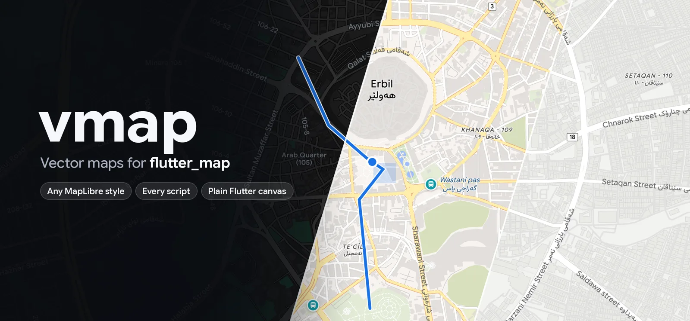

<p align="center">
  
</p>

<h1 align="center">vmap</h1>

<p align="center">
  Maps for Flutter, drawn on the GPU.<br>
  Any MapLibre style, 3D buildings and terrain, labels in every script.<br>
  Android, iOS, macOS, Windows, Linux and the web.
</p>

---

- **Any MapLibre style.** vmap passes 1,394 of the 1,519 MapLibre render
  tests that apply to it, and draws real styles within a few percent of
  MapLibre GL JS.
- **3D.** Buildings with depth, terrain draped with the map, sky and fog,
  the globe, and tilt up to 85 degrees.
- **Labels in every script.** Arabic and Kurdish are shaped correctly, and
  labels are placed as MapLibre places them, steady while the map moves.
- **Flutter all the way down.** One widget, markers that are widgets, and
  gestures for touch, mouse, trackpad and keyboard. No platform views.
- **Your data.** GeoJSON with clustering, feature state for highlighting,
  and taps that tell you what was hit.
- **Offline.** A disk cache, regions downloaded ahead, and PMTiles archives.

## Get started

**1. Add the package.** vmap needs Flutter 3.47.1 or newer.

```bash
flutter pub add vmap
```

**2. Switch Flutter GPU on** in your app's platform folders, and let it load
tiles:

```bash
dart run vmap:setup
```

It edits the Android manifest, the iOS and macOS `Info.plist` files and
entitlements, and the Windows and Linux runners, and changes nothing that is
already set. `dart run vmap:setup --check` only reports, and fails if
anything is missing, for CI. The web needs nothing.

**3. Show a map.**

```dart
import 'package:flutter/material.dart';
import 'package:vmap/vmap.dart';

class MapPage extends StatelessWidget {
  const MapPage({super.key});

  @override
  Widget build(BuildContext context) => const Scaffold(
    body: Vmap(
      initialCamera: VmapCamera(center: LatLng(36.19, 44.01), zoom: 14),
    ),
  );
}
```

That is a whole map: vmap's built in style over
[OpenFreeMap](https://openfreemap.org) tiles, which need no key, with
gestures and the tiles' credit in the corner. The
[example app](example/lib/main.dart) adds a style switcher, a marker, taps
and 3D in about a hundred lines.

<details>
<summary>What <code>vmap:setup</code> changes, to do it by hand</summary>

| Platform | File | Add |
| --- | --- | --- |
| Android | `android/app/src/main/AndroidManifest.xml`, inside `<application>` | `<meta-data android:name="io.flutter.embedding.android.EnableFlutterGPU" android:value="true" />` |
| Android | the same file, inside `<manifest>` | `<uses-permission android:name="android.permission.INTERNET"/>` |
| iOS, macOS | `ios/Runner/Info.plist`, `macos/Runner/Info.plist` | `<key>FLTEnableFlutterGPU</key><true/>` |
| macOS | `macos/Runner/DebugProfile.entitlements`, `Release.entitlements` | `<key>com.apple.security.network.client</key><true/>` |
| Windows | `windows/runner/main.cpp`, after `DartProject project(...)` | `project.set_enable_flutter_gpu(true);` |
| Linux | `linux/runner/my_application.cc`, after `fl_dart_project_new()` | `fl_dart_project_set_enable_flutter_gpu(project, TRUE);` |

`flutter run --enable-flutter-gpu` switches Flutter GPU on for one run.
Where it is off or missing, vmap draws with Flutter's canvas instead: flat
buildings, no terrain or globe. Debug builds say so in the console, and
`onError` hears it as a `VmapErrorKind.gpu` error.

</details>

## Styles

```dart
Vmap(style: VmapStyle.light)   // the default, built in
Vmap(style: VmapStyle.dark)    // built in
Vmap(style: VmapStyle.url('https://tiles.openfreemap.org/styles/liberty'))
Vmap(style: VmapStyle.json(myStyleDocument))
```

The style decides the look and where the tiles come from. Styles are
compared by content, so building one in `build` is fine.

Change single layers without writing the style out again, by layer `id`:

```dart
Vmap(
  style: VmapStyle.url('https://tiles.openfreemap.org/styles/liberty'),
  styleEdits: [
    const VmapStyleEdit.paint('water', 'fill-color', '#2a6fdb'),
    const VmapStyleEdit.visible('building', false),
    const VmapStyleEdit.filter('poi_r1', ['==', 'class', 'hospital']),
    VmapStyleEdit.zoomRange('road_minor', min: 14),
  ],
)
```

These are MapLibre's `setPaintProperty`, `setLayoutProperty`, `setFilter`
and `setLayerZoomRange`. A paint change animates as the style's transitions
say; the others rebuild the tiles behind what is on screen.

## The camera

A `VmapController` moves the map and reads where it looks.

```dart
final controller = VmapController(
  const VmapCamera(center: LatLng(36.19, 44.01), zoom: 14),
);

Vmap(controller: controller)

controller.flyTo(const VmapCamera(center: LatLng(35.56, 45.44), zoom: 15, pitch: 55));
controller.easeTo(controller.camera.copyWith(bearing: 90));
controller.fitBounds(VmapBounds.around(points), padding: const EdgeInsets.all(40));
controller.camera = someCamera; // jump
```

Zooms are MapLibre's: the world is 512 pixels wide at zoom 0. `flyTo`
follows MapLibre's path, rising over long distances, and a released gesture
or an interrupted animation keeps its speed. `VmapCamera.padding` keeps part
of the map free, under a bottom sheet for example. `toScreen` and
`toLatLng` convert between places and points on the map.

### Gestures

| Input | What it does |
| --- | --- |
| Touch | One finger pans. Two pinch to zoom and twist to turn, and tilt when dragged up or down together. A double tap zooms in, a two finger tap zooms out, and a double tap held and dragged zooms. |
| Mouse | The wheel zooms about the pointer. A double click zooms in, and with shift, out. A right drag or a control drag turns and tilts. A shift drag zooms to the box it draws. |
| Trackpad | Two fingers slide the map, a pinch zooms about the fingers, and a twist turns it. |
| Keyboard | Once the map has focus: the arrows pan, shift with them turns and tilts, and `+` and `-` zoom a level, two with shift. |

`rotate`, `tilt`, `keyboard` and `interactive` switch them off.

## Taps and features

```dart
Vmap(
  onTap: (point) => print('tapped $point'),
  onFeatureTap: (feature, point) {
    print('${feature.properties['name']} in ${feature.layers.first}');
  },
  tappableLayers: const ['poi', 'my-route'], // optional
)
```

`onFeatureTap` gets the topmost feature under a tap: a road, a place, a
building, or one of your own. Each feature has its properties, its source,
the style layers that draw it, and its geometry. `tappableLayers` limits it
to some layers, as MapLibre's `map.on('click', layerId)` does.

For everything at a point, or in an area, ask the controller:

```dart
final here = await controller.featuresAt(point);
final inView = await controller.featuresIn(VmapBounds.around(corners));
```

To highlight a feature, give it state that the style reads with
`['feature-state', name]`:

```dart
Vmap(
  featureStates: [
    if (picked != null) VmapFeatureState.of(picked!, const {'picked': true}),
  ],
)
```

with a paint property such as
`['case', ['==', ['feature-state', 'picked'], true], '#E5484D', '#1A73E8']`.
The feature needs an id: a GeoJSON feature's `id`, the id its vector tile
carries, or a property named by the source's `promoteId`.

## Markers

Markers are widgets at places. Map labels keep out of their way, and a
marker's `name` is written beside it when there is room.

```dart
Vmap(
  markers: [
    VmapMarker(
      point: const LatLng(36.18946, 44.00970),
      name: 'Machko Chaikhana',
      width: 32,
      height: 32,
      alignment: Alignment.topCenter, // the box sits above the point
      child: GestureDetector(
        onTap: showCafe,
        child: const Icon(Icons.location_on, size: 32),
      ),
    ),
  ],
)
```

A tap on a marker belongs to the marker and does not reach `onTap`.

`pins: VmapPins.standard` draws the style's places of interest as round
pins instead of its small icons. It uses Material icons, so the app needs
`uses-material-design: true`.

## Your own data

An overlay adds sources and layers to whatever style is showing, written as
a MapLibre style writes them:

```dart
Vmap(
  overlay: VmapOverlay(
    sources: {
      'route': {
        'type': 'geojson',
        'data': {
          'type': 'LineString',
          'coordinates': [[44.0053, 36.1930], [44.0087, 36.1890]],
        },
      },
    },
    layers: const [
      {
        'id': 'route',
        'type': 'line',
        'source': 'route',
        'layout': {'line-cap': 'round'},
        'paint': {'line-color': '#1A73E8', 'line-width': 5},
      },
    ],
  ),
)
```

- A layer with `'before': 'some-layer-id'` is drawn under that style layer.
- `data` may also be the address of a GeoJSON file.
- Overlays are compared by content. Change `data` to move things: the old
  features stay up until the new ones are ready, so a moving dot does not
  blink.
- A GeoJSON source with `'cluster': true` clusters its points as MapLibre
  does. `controller.clusterExpansionZoom`, `clusterChildren` and
  `clusterLeaves` tell where a tapped cluster comes apart and what it holds.

## Labels and languages

```dart
Vmap(
  style: VmapStyle.url(styleUrl, nameKeys: ['name:en', 'name']),
  textStyle: const VmapTextStyle(fontFamily: 'Inter'),
)
```

`nameKeys` picks the label language, tried in order. Letters come from the
style's glyph ranges, as MapLibre draws them, and from fonts for what the
ranges cannot shape, such as the Kurdish letters ڵ and ێ.
`VmapRenderOptions(glyphs: VmapGlyphs.fonts)` draws every label from fonts.

vmap ships Vazirmatn and Noto Sans Syriac Eastern (300 KB together), so
Arabic script and Syriac work with no setup. Text drawn from fonts goes
through vmap's own OpenType shaper, written in Dart and tested against
HarfBuzz glyph for glyph: joining forms, ligatures, kerning, mark placement,
variable weights, and right-to-left text in the Unicode bidirectional
order. Fonts need TrueType outlines (`.ttf`); the reordering that Indic and
Southeast Asian scripts need is not done yet.

## Offline

```dart
Vmap(
  controller: controller,
  network: VmapNetworkOptions(cacheDirectory: '${dir.path}/vmap'),
)

final result = await controller.downloadRegion(
  VmapBounds(const LatLng(36.10, 43.90), const LatLng(36.30, 44.15)),
  minZoom: 10,
  maxZoom: 16,
  onProgress: (done, total) => print('$done of $total'),
);
```

With a cache directory, tiles, styles and sprites are kept between runs, and
the next start draws from disk at once while it checks the server.
`downloadRegion` fetches every tile the style draws for an area ahead of
time; the count grows fourfold with each zoom, so check the terms of your
tile server first.

A source whose address starts with `pmtiles://` is read from a
[PMTiles](https://docs.protomaps.com/pmtiles/) archive, on a server that
answers range requests or on the device. `VmapNetworkOptions` also sets the
user agent and headers sent with every request, for servers that want a key.

## Loading, events and errors

```dart
Vmap(
  loadingBuilder: (context) => const Center(child: CircularProgressIndicator()),
  onStyleLoaded: () {},
  onCameraMove: (camera) {},
  onCameraIdle: (camera) {},
  onIdle: () {},
  onError: (error) => log('${error.kind} ${error.url}: ${error.cause}'),
)
```

The loading builder covers the map until it first draws tiles. `onError`
hears every style, tile, sprite, font or GPU failure; the map keeps retrying
where that can help.

## 3D, terrain and the globe

Styles with `fill-extrusion` layers stand their buildings up when the map is
tilted. A style's `terrain` raises the ground, or an overlay adds one:

```dart
const VmapOverlay(
  sources: {
    'dem': {
      'type': 'raster-dem',
      'tiles': ['https://s3.amazonaws.com/elevation-tiles-prod/terrarium/{z}/{x}/{y}.png'],
      'encoding': 'terrarium',
      'maxzoom': 15,
    },
  },
  terrain: {'source': 'dem', 'exaggeration': 1.5},
)
```

A style with `"projection": {"type": "globe"}` draws the globe at low
zooms, and `sky` draws the sky and fog past the horizon.

## The web

Build with WebAssembly, and serve Flutter's engine from your own host:

```bash
flutter build web --wasm --no-web-resources-cdn
```

The WebAssembly build draws on a thread of its own, which leaves the page's
thread to the map: panning over Erbil on an Apple silicon Mac, the page's
thread sat idle about two thirds of the time, against a tenth in the
JavaScript build. That thread needs the page served cross-origin isolated:

```
Cross-Origin-Opener-Policy: same-origin
Cross-Origin-Embedder-Policy: require-corp
```

Browsers without WebAssembly garbage collection get the JavaScript build,
which draws the map too. Tiles are built in a web worker vmap ships. There
is no disk cache in a browser, and a PMTiles archive has to be at an
`https://` address.

## Platforms

| Platform | Draws with | Tried on |
| --- | --- | --- |
| Android 10 and newer | the GPU, on Vulkan or OpenGL ES | a phone and the emulator |
| Android 9 and older | the canvas | not yet |
| iOS | the GPU | not yet |
| macOS | the GPU | most development |
| Windows, Linux | the GPU | not yet |
| Web | the GPU, through WebGL2 | Chrome |

Flutter GPU is still a preview in Flutter itself. The details, with
sources, are in [doc/platform-support.md](doc/platform-support.md).

## flutter_map

Apps already on [flutter_map](https://pub.dev/packages/flutter_map) can
draw vmap's maps in it with the
[vmap_flutter_map](https://github.com/ArinFaraj/vmap/tree/main/vmap_flutter_map)
package: a layer that goes where a `TileLayer` would, without tilt or 3D.

## Coming from vmap 0.26

- `VmapLayer`, `VmapMap` (now `VmapFlutterMap`), `VmapGestures` and
  `NamedMarker` moved to `vmap_flutter_map`.
- `VMap` and `VMapController` are `Vmap` and `VmapController`, and
  `MapCameraPosition` is `VmapCamera`, with a `LatLng` center.
- The GPU renderer is the default; pick the canvas with
  `VmapRenderOptions(renderer: VmapRenderer.canvas)`.
- Engine settings are grouped in `VmapNetworkOptions` (was
  `TileSourceConfig`), `VmapRenderOptions` and `VmapLabelOptions`.
- Every zoom is MapLibre's, one below flutter_map's.
- `onError` receives a `VmapError`, and statistics are in
  `package:vmap/debug.dart`.

## License

MIT. vmap bundles Vazirmatn and Noto Sans Syriac Eastern under the SIL Open
Font License, its Unicode tables come from the Unicode Character Database
(Unicode License V3), and its WebGL2 backend comes from
[flutter_scene](https://pub.dev/packages/flutter_scene) (MIT). Map data in
the pictures is from OpenStreetMap.
