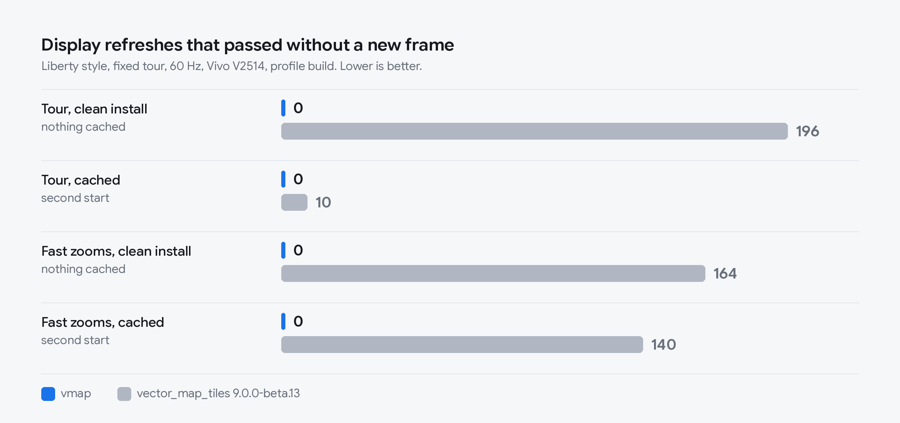
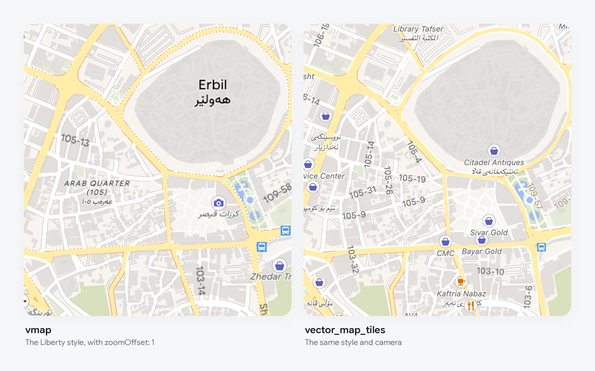

# Benchmark against vector_map_tiles



Both renderers drew the Liberty style on the same phone (Vivo V2514, Android,
profile build) and flew the same scripted tour twice per start: once straight
after a clean install with nothing cached, then again after a restart with the
cache that run left behind. A lost frame is a display refresh that passed
without a new frame. The numbers are from vmap 0.3.0 and vector_map_tiles
9.0.0-beta.13.

| | vmap lost | vmap worst gap | vector_map_tiles lost | vector_map_tiles worst gap |
| --- | --- | --- | --- | --- |
| Tour, clean install | 0 of 2778 | 17 ms | 196 of 2779 | 132 ms |
| Tour, cached | 0 of 2775 | 17 ms | 10 of 2779 | 132 ms |
| Fast zooms, clean install | 0 of 1328 | 17 ms | 164 of 1325 | 166 ms |
| Fast zooms, cached | 0 of 1327 | 18 ms | 140 of 1321 | 166 ms |

## What this does and does not show

- The phone ran both apps at 60 Hz, so a frame had 16.6 ms. It was one run
  per row on one phone.
- vmap does more work per frame, because it redraws the vectors every frame:
  about 3 ms on the UI thread and 4 ms on the raster thread at the median,
  against 1 to 2 ms each for vector_map_tiles, which mostly draws finished
  images.
- The slowest 1 percent of vmap's frames took 6.6 to 7.2 ms on the UI thread
  and 6.4 to 8.2 ms on the raster thread in later single lap runs of version
  0.3.2. A frame has 8.3 ms at 120 Hz. 120 Hz itself has not been measured:
  the phone held both apps at 60 Hz.
- vector_map_tiles lost its frames in long gaps while waiting for tiles to be
  rendered, not in slow frames of its own.
- vmap's process used about 440 to 490 MB. vector_map_tiles' memory was not
  recorded.
- Pins (0.4.0) were not part of any of these runs.

## The comparison picture



The same style, camera and tiles. vector_map_tiles reads a style one zoom
level deeper than MapLibre does for the same view, so for this picture vmap
was given `zoomOffset: 1` to match. vector_map_tiles shows more shops in this
view than vmap does. The style holds those layers back until zoom 16 and 17,
and vmap follows that. Why vector_map_tiles shows them earlier has not been
traced.

## Run it yourself

```bash
tool/bench_device.sh <adb-serial> ours --dart-define=STYLE=liberty --dart-define=ZOFF=1
tool/bench_device.sh <adb-serial> vmt --dart-define=STYLE=liberty
```

`STYLE` gives both the same style, and `ZOFF=1` makes vmap read it at the
zoom vector_map_tiles does, so both draw the same roads and names. Add
`--dart-define=STRESS=true` for the tour of fast zooms.

Once a build is installed, `tool/quick_bench.sh <adb-serial>` flies one lap
again in about half a minute without rebuilding. Add `labels=off` to fly it
with labels off.
